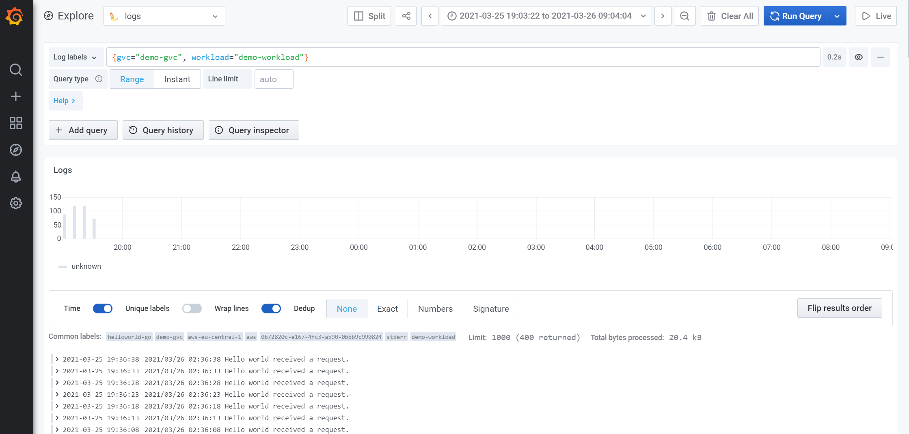

## Overview

The Logs UI aggregates logs for running [workloads](/concepts/workload) across all configured cloud providers and regions. Logs are displayed in a single view, regardless of where the workload replicas are running.

Use [filters](#log-filters) to investigate issues for a specific [workload](/concepts/workload), [location](/reference/location), or container.

Use [Grafana Explore](https://grafana.com/docs/grafana/latest/explore/) to query, visualize, and analyze log data.

## LogQL

Control Plane logs use LogQL to query log data.

For syntax and query examples, see the [LogQL documentation](https://grafana.com/docs/loki/latest/logql/).

The following labels can be used to create a query:

- container
- gvc
- location
- provider
- replica
- stream
- workload

## Log Filters

Query results can be filtered by the following:

- [Location](/reference/location)
- [Container](/reference/workload/containers)
- Start date and optional end date (the date/time selector includes helper buttons ranging from the `Last 5 minutes` to the `Last 30 days`)

Selecting a [location](/reference/location) or [container](/reference/workload/containers) automatically adds the value to the LogQL query.

## Live Logs

Log streams can be viewed in real time using the `Live` option.

After entering the desired query, click `Live` to begin streaming logs.

Click `Stop` to end the live stream.

## Grafana

Clicking the `Explore on Grafana` link opens Grafana in a new tab. When you open Grafana from a specific [workload](/concepts/workload), the query is prefilled with the [GVC](/reference/gvc) and [workload](/concepts/workload).

Grafana gives you the ability to "Explore your data through ad-hoc queries and dynamic drill-down. Split view and compare different time ranges, queries, and data sources side by side."

View the [Grafana Explore documentation](https://grafana.com/docs/grafana/latest/explore/).

The following image shows the Grafana UI after executing a query:

<Frame>
  
</Frame>

### Grafana access

Grafana is reached from the [Console](https://console.cpln.io/console/) through the `Explore on Grafana` link on the logs page, or by going to **Metrics**. Access is derived from the signed-in user's permissions on the [org](/reference/org#permissions):

| Role in Grafana | Who gets it                                                                  |
| :-------------- | :--------------------------------------------------------------------------- |
| Viewer          | Every member of the org, through the built-in `view` grant to all members   |
| Admin           | Users granted the `grafanaAdmin` org permission, directly or through `manage` |
| No access       | Users who are not members of the org                                         |

Signing in to Grafana does not by itself show data. Every query is checked against the signed-in user's own permissions on the org:

- `readLogs` to query logs.
- `readMetrics` to query metrics and traces.

The Grafana role is re-synced at most once every 30 minutes, so a change to `grafanaAdmin` can take up to 30 minutes to apply.

Grant `grafanaAdmin` only to users who need to manage Grafana itself, such as data sources, dashboards, and alert rules for the org.

The following policy gives every member of the `observability-viewers` [group](/reference/group) the ability to read logs and metrics in Grafana as a Viewer.

<CodeGroup>

```bash CLI
cpln policy create --name grafana-viewers \
  --target-kind org \
  --all

cpln policy add-binding grafana-viewers \
  --permission readLogs \
  --group observability-viewers

cpln policy add-binding grafana-viewers \
  --permission readMetrics \
  --group observability-viewers
```

```yaml YAML
kind: policy
name: grafana-viewers
description: Read logs and metrics in Grafana
tags: {}
targetKind: org
target: all
bindings:
  - permissions:
      - readLogs
      - readMetrics
    principalLinks:
      - //group/observability-viewers
```

</CodeGroup>

The following policy makes every member of the `observability-admins` group an Admin in Grafana.

<CodeGroup>

```bash CLI
cpln policy create --name grafana-admins \
  --target-kind org \
  --all

cpln policy add-binding grafana-admins \
  --permission grafanaAdmin \
  --group observability-admins

cpln policy add-binding grafana-admins \
  --permission readLogs \
  --group observability-admins

cpln policy add-binding grafana-admins \
  --permission readMetrics \
  --group observability-admins
```

```yaml YAML
kind: policy
name: grafana-admins
description: Grafana Admin with access to logs and metrics
tags: {}
targetKind: org
target: all
bindings:
  - permissions:
      - grafanaAdmin
      - readLogs
      - readMetrics
    principalLinks:
      - //group/observability-admins
```

</CodeGroup>

### Service accounts

Use a Grafana service account to call the Grafana HTTP API from automation without an interactive sign-in. Requests that carry a service account token (`glsa_...`) are not signed in through Control Plane; Grafana validates the token itself. A service account belongs to the Grafana organization of your org.

1. Sign in to Grafana as a user with the Admin role. Creating service accounts and tokens requires Admin, which Grafana grants to users with the `grafanaAdmin` [org permission](/reference/org#permissions) (see [Grafana access](#grafana-access)).
2. Go to **Administration** > **Users and access** > **Service accounts**, and select **Add service account**.
3. Select **Add service account token**, set an expiration, and copy the generated `glsa_` token. It is shown only once.

Send the token as a bearer token to your org's Grafana host, where `ORG_NAME` is your org name:

```bash
curl -H "Authorization: Bearer glsa_TOKEN" \
  https://ORG_NAME.grafana.cpln.io/api/search
```

<Note>
  Data source queries sent to `/api/ds/query` (what dashboards and Explore use) with a service account token are denied. Grafana identifies a service account by its own login, which is not a member of your org, so the `readLogs` and `readMetrics` checks described in [Grafana access](#grafana-access) fail. To query logs or metrics from automation, use a Control Plane [service account](/reference/serviceaccount) granted `readLogs` or `readMetrics`.
</Note>

## Example LogQL Queries

- View the logs for a specific [GVC](/reference/gvc) and [workload](/concepts/workload)

```log Query
{gvc="GVC_NAME", workload="WORKLOAD_NAME"}
```

- Access logs with errors

```log Query
{gvc="GVC_NAME", workload="WORKLOAD_NAME", container="_accesslog"}  |= "\" 50"
```

- Graph access log errors by replica

```log Query
sum(count_over_time({gvc="GVC_NAME", workload="WORKLOAD_NAME", container="_accesslog"}  |= "\" 50"[1m])) by (replica)
```

- Graph access log errors by workload

```log Query
sum(count_over_time({gvc="GVC_NAME", container="_accesslog"}  |= "\" 50"[1m])) by (workload)
```

- View the logs for a GVC, workload, location, and container

```log Query
{gvc="GVC_NAME", workload="WORKLOAD_NAME", location="aws-eu-central-1", container="CONTAINER_NAME"}
```

- View logs across all workloads and GVCs

```log Query
{gvc=~".+"}
```

- Count inbound requests by IP

This query produces a count of inbound requests grouped by source IP address over the last 10 minutes.
Set the Grafana query type to `Instant` so the results can be returned as a sortable list.

```log Query
sum(count_over_time({gvc="GVC_NAME", workload="WORKLOAD_NAME", container="_accesslog"} | logfmt | regexp "(?P<ip>\\d+\\.\\d+\\.\\d+\\.\\d+)"[10m])) by (ip)
```

- Count inbound requests by path

This query returns the count of inbound requests grouped by request path for the last 10 minutes where latency exceeds 100ms.
Set the Grafana query type to `Instant` so the results can be returned as a sortable list.


```log Query
sum(count_over_time({gvc="GVC_NAME", workload="WORKLOAD_NAME", container="_accesslog"} | logfmt | regexp "(?P<path>\\/[^\"]*\\s).+\\d+ \\d+ \\d+ (?P<latency>\\d+) " | latency > 100 [10m])) by (workload, path)
```


## Log Retention Policy

Logs are stored for 30 days by default. The retention period can be set for each [org](/reference/org) with `spec.observability.logsRetentionDays`, up to a **maximum of 730 days (2 years)**. Metrics and traces have their own retention settings with the same default and maximum. See [observability retention](/reference/org#observability-retention).

To keep logs for longer than 730 days, ship them to an external provider.

Learn how to [configure log shipping to an external provider](/external-logging/overview).

## CLI

To view the CLI documentation for logs, see the [Logs CLI reference](/cli-reference/commands/logs).
