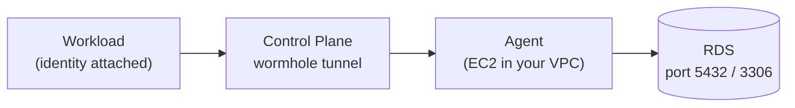

## Overview

Follow the steps below to let a [workload](/reference/workload) connect to an [Amazon RDS](https://docs.aws.amazon.com/AmazonRDS/latest/UserGuide/Welcome.html) database that has no public access. An [agent](/reference/agent) running in the same VPC as the database tunnels the connection, and an [identity](/reference/identity) grants access to the database host and port from the workload to the database, tunneling through the agent.



<Info>
To connect to RDS without running an agent, use [AWS PrivateLink](/guides/native-networking/aws-privatelink/privatelink-rds-terraform) instead.
</Info>

## Prerequisites

- Review the [Agent](/reference/agent) and [Identity](/reference/identity) reference pages.
- An [AWS](https://aws.amazon.com/) account and permission to manage EC2, RDS, and VPC security groups.
- A Control Plane [GVC](/reference/gvc) and a workload (or an image to deploy) that needs to reach the database.

## Step One - Prepare the RDS Instance

1. In the AWS Console, navigate to `RDS` and create (or select) your database. Note the VPC it runs in.
2. Under `Connectivity`, set `Public access` to `No`. The database does not need a public IP address because the agent reaches it from inside the VPC.
3. Create a dedicated security group for the database (e.g., `rds-private-sg`) and attach it to the instance. You will add its inbound rule in [step three](#step-three-allow-the-agent-to-reach-rds).
4. Once the database is available, copy its endpoint hostname from the `Connectivity & security` tab (e.g., `mydb.abc123xyz.us-east-1.rds.amazonaws.com`) and its port. The default port is `5432` for PostgreSQL and `3306` for MySQL.

<Note>
Always use the endpoint hostname, not an IP address. RDS can change the IP address behind an endpoint, for example during a Multi-AZ failover.
</Note>

## Step Two - Deploy an Agent in the Same VPC

Follow the [AWS section of the Configure an Agent](/guides/setup-agent#aws) guide, and choose the **same VPC** that the RDS instance runs in when you create the Auto Scaling Group.

Give the agent's launch template its own security group (e.g., `cpln-agent-sg`) so you can reference it in the next step. The agent opens outbound connections to Control Plane, so follow that guide's networking notes: the VPC must have an `Internet Gateway` attached and the agent's subnet must assign a public IPv4 address. For production, run at least two agents for redundancy.

When the agent's heartbeat is green in the `Agents` page of the Control Plane UI, continue.

## Step Three - Allow the Agent to Reach RDS

The agent connects to the database from inside the VPC, so the database's security group must allow inbound traffic from the agent's security group on the database port.

1. In the AWS Console, navigate to `VPC`, click `Security Groups`, and select the database's security group (`rds-private-sg`).
2. Click `Edit inbound rules`, then `Add rule`.
3. Set `Type` to `PostgreSQL` (port `5432`) or `MYSQL/Aurora` (port `3306`), or choose `Custom TCP` and enter the port used by your database.
4. Set `Source` to the agent's security group (`cpln-agent-sg`).
5. Click `Save rules`.

<Tip>
Using the agent's security group as the source, rather than a CIDR range, keeps the rule valid as agent instances are replaced or scaled.
</Tip>

If the agent and the database are in different VPCs, the VPCs must be connected (for example with VPC peering or a transit gateway) and the routes and security groups must allow the traffic.

## Step Four - Create the Identity Network Resource

Create an [identity](/reference/identity) in the same GVC as your workload with a [network resource](/reference/identity#network-resources-networkresources) that points at the RDS endpoint through the agent.

<Tabs>
  <Tab title="Console">
    1. Follow the [Create an Identity](/guides/create-identity) guide to create a new identity in your GVC, or open an existing one to edit.
    2. Under `Cloud Wormhole`, select `FQDN Resources` and click `Add FQDN`.
    3. Enter the RDS endpoint hostname as the `FQDN` (e.g., `mydb.abc123xyz.us-east-1.rds.amazonaws.com`).
    4. Enter a unique `name` for the resource that differs from the FQDN (e.g., `my-rds`).
    5. Select the agent you created in step two.
    6. Under `Ports`, add the database port (`5432` or `3306`).
    7. Click `Add`, then click `Create`.
  </Tab>
  <Tab title="CLI">
    Save the following as `rds-identity.yaml`, replacing the agent name, FQDN, and port with your own values:

    ```yaml
    kind: identity
    name: rds-identity
    gvc: my-gvc
    networkResources:
      - name: my-rds
        agentLink: //agent/my-agent
        FQDN: mydb.abc123xyz.us-east-1.rds.amazonaws.com
        ports:
          - 5432
    ```

    Apply it:

    ```bash
    cpln apply --file rds-identity.yaml --org my-org
    ```
  </Tab>
</Tabs>

A few details about the network resource:

- `FQDN` and `IPs` are mutually exclusive, and one of them is required. Use the RDS endpoint as the `FQDN`. The agent resolves the hostname from inside your VPC, so it resolves to the database's private address. Optionally set `resolverIP` to the IPv4 address of a DNS server the agent queries to resolve the `FQDN`, instead of its default resolver.
- `ports` must list every port your application connects to. A resource accepts 1 to 10 ports.
- `agentLink` is the link to the agent. All agents referenced by one identity must have the same protocol version.
- `name` must be unique within the identity and must not match any `FQDN` in it.
- If you connect to more than one endpoint of an Aurora cluster or Multi-AZ DB cluster (for example, the writer and the reader endpoints), create one network resource per endpoint.

## Step Five - Attach the Identity to the Workload

An identity only takes effect once it is attached to the workload that needs the connection.

- **Console:** Open the workload, click `Identity` in the left pane, select the identity, and click `Save`. See the [workload general settings](/reference/workload/general#identity).
- **CLI/YAML:** Set `spec.identityLink` on the workload to `//identity/rds-identity`.

The identity must be in the same GVC as the workload. Wait for the workload rollout to complete before testing.

## Step Six - Connect from the Workload

Inside the workload, connect to the database using the **same hostname as the identity's `FQDN`** and the database port. No client library or code changes are required. For example, with PostgreSQL:

```bash
psql "host=mydb.abc123xyz.us-east-1.rds.amazonaws.com port=5432 dbname=mydb user=myuser sslmode=require"
```

Or as a connection string in your application's environment variables:

```text
postgresql://myuser:<password>@mydb.abc123xyz.us-east-1.rds.amazonaws.com:5432/mydb?sslmode=require
```

For MySQL, use the same hostname with port `3306`.

<Warning>
Store the database password in a [secret](/reference/secret) rather than in plain text. To read it, the workload needs a [policy](/reference/policy) that grants `reveal` on the secret to `rds-identity` (the identity attached in step five), plus a `cpln://secret/SECRET_NAME.KEY` reference in the workload's environment variables. See [Create a Secret](/guides/create-secret).
</Warning>

### TLS

The workload can call the resource using either the FQDN or the `name` from the identity. If the database uses TLS, the FQDN must be used. RDS certificates are issued for the endpoint hostname, so connecting by `name` fails hostname verification (for example with `sslmode=verify-full`). The `sslmode=require` examples above do not verify the hostname, so they also work with the `name`. Connect with the FQDN and, to validate the server certificate, provide the [RDS certificate bundle](https://docs.aws.amazon.com/AmazonRDS/latest/UserGuide/UsingWithRDS.SSL.html) to your client (for example, `sslmode=verify-full` with `sslrootcert` for PostgreSQL).

## Troubleshooting

<AccordionGroup>
<Accordion title="Agent shows no recent heartbeat">
  **Cause:** The agent cannot open outbound connections to Control Plane.

  **Fix:** Confirm the agent's VPC has an `Internet Gateway`, its subnet assigns a public IPv4 address, and the instance can make outbound connections. See [Configure an Agent](/guides/setup-agent#aws).
</Accordion>

<Accordion title="connection timed out">
  **Cause:** The agent cannot reach the database on its port. Typically the database security group does not allow the agent, or the agent runs in a different, unrouted VPC.

  **Fix:** Allow inbound traffic on the database port from the agent's security group, and run the agent in the same VPC (or a routed one).
</Accordion>

<Accordion title="could not translate host name">
  **Cause:** The hostname does not resolve in the workload. The identity is not applied to the workload, or the connection uses a hostname that is not the identity's `FQDN` or `name`.

  **Fix:** Attach the identity to the workload, make sure it is in the same GVC, wait for the workload rollout to finish, and connect with the exact `FQDN`.
</Accordion>

<Accordion title="Certificate or hostname verification error">
  **Cause:** The client verifies the server certificate hostname (for example with `sslmode=verify-full`) but connects with the resource `name`. RDS certificates are issued for the endpoint hostname.

  **Fix:** Connect with the `FQDN`, not the resource `name`.
</Accordion>

<Accordion title="Connection refused">
  **Cause:** The agent reached the database host, but nothing is listening on the port used.

  **Fix:** Make sure the port in the network resource matches the port the database listens on.
</Accordion>
</AccordionGroup>

## Next Steps

- Review the [identity network resources](/reference/identity#network-resources-networkresources) reference.
- Run at least two agents for [high availability](/reference/agent#high-availability-ha).
